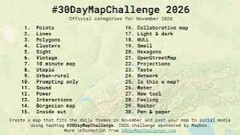

# The null_island project

## Overview of Project
As day 18 of the 2026 30 Day Map Challenge I decided to make a treasure style map of Null Island. This was a simple mapping exercise for this challenge in order to use some of my skills. 



# Repository Structure

```text
null_island/
├── images
│   ├── compass_rose_transparent.png
│   ├── kraken.png
│   ├── kraken2.png
│   ├── pirate_ship.png
│   └── placeholder.txt
├── maps
│   ├── null_island_treasure_map.jpg
│   └── 30daymapchallenge.jpg
├── scripts
│   └── Null_Island.py
└── README.md
```

## Installation Notes
# Interactive Map
Created using Python 3.15.2 within VSCode 1.146.0 on 17th November 2026.
<br>
Needed prerequisites: Folium and OS.

```py
import folium
import os
```

# Static Map Output
ArcGIS Pro 3.7
John Nelson 'Pirate Map Style' stylx file available at: https://esri-styles.maps.arcgis.com/home/item.html?id=58e11ce83ae64dcf87b084dd3b9bbcd2#overview
John Nelson 'Tattered Map Sandwich sample ArcGIS Pro project' available at: [https://esri-styles.maps.arcgis.com/home/item.html?id=58e11ce83ae64dcf87b084dd3b9bbcd2#overview](https://nation.maps.arcgis.com/home/item.html?id=69a2fbbd53ea4795a31e6142a22aaa59#overview)

## Author
Sian Lake
Produced as a passion project for the 30 day map challenge 2026 - Day 18 "Null".
